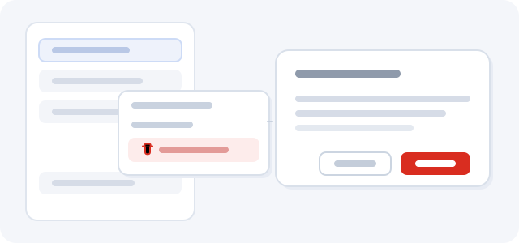

# dsh-session-delete

给 DeepSeek Harness（DSH）加一个「彻底删除会话」的动作：会话栏右键 → **删除会话…** → 确认，会话目录连同对话记录一起从磁盘移除，而不是只能归档。



## 为什么需要它

DSH 的会话列表只提供「归档」：归档只是把会话 id 写进 `workspace.json` 的 `archivedSessionIds`，正文仍留在磁盘上，而且会话越攒越多。这个插件补上了真正的删除。

## 功能

- 会话行右键菜单里的原生条目「删除会话…」，使用系统图标、原生对话框，跟随 DSH 的浅色/深色主题。
- 删除前把该会话从「归档」「置顶」集合里摘掉，菜单里不会留下幽灵条目。
- 删除后自动刷新会话列表，行立即消失。
- 中英双语（跟随界面语言）。

## 安装

插件是一个普通的 DSH bundle 包，可以直接用 DSH 的插件安装流程安装：

1. 把本仓库放到本机任意目录，例如 `D:\tools\dsh-session-delete`。
2. 在 DSH 里让 agent 执行：`plugin_manager action:install_bundle target:"D:\tools\dsh-session-delete"`（或使用插件页的「安装本地插件」入口）。
3. 结果里出现 `application: applied` 即生效。**Host 半在 DSH 启动时加载，安装后需要重启 DSH**；客户端半刷新页面即可。
4. 卸载：`plugin_manager action:remove_bundle target:"@local/dsh-session-delete"`。

包名 `@local/dsh-session-delete` 是为了和 DSH 官方本地插件模板保持一致（`@local/*` 为本地作用域，不会与 npm registry 冲突）。

## 安全设计

删除是不可撤销的破坏性操作，所以每次删除都要过这几道检查（任一不满足就拒绝并给出原因）：

| 检查 | 拒绝时的提示 |
| --- | --- |
| 该会话没有任何正在运行的活动（agent / 子代理 / 后台任务 / 定时任务） | 这个会话还有正在运行的工作，先停止再删除 |
| 目标正是当前窗口打开的会话 → 弹窗里直接说明，「永久删除」不可点 | 这个会话正在当前窗口打开，请先切换到别的会话再删除 |
| 磁盘布局符合 `<root>/--<项目>--/<会话id>/session.vN.jsonl.zstd` | 会话目录结构不符合预期，已中止 |
| 目录未被其它程序独占（被占用时自动重试 3 次） | 有其他程序占用着这个会话的文件，请稍后重试，或重启 DSH |
| 递归删除会话目录（子代理会话目录嵌在父目录内，一并清理） | — |
| 删除后摘除归档/置顶记录 | — |

搜索索引（sqlite）不需要手工清理：DSH 的搜索服务每次检索时会与持久化快照对账，发现来源已删除会自动清掉对应文档。

## 限制

- 只删除会话的持久化数据（磁盘上的会话目录）与列表记录；不触碰工作区本身。
- 删除当前窗口正在显示的会话会被拦下；想删它请先切到别的会话。
- 依赖 DSH 的会话持久化与上下文菜单扩展点（`sessionPersistence`、`workspaceRegistry`、`contextMenus`、`shell.overlay`）。这些接口在新版 DSH 中若变更，需要同步调整。

## 仓库结构

```
index.js            Host 半：POST /api/dsh-session-delete/delete，做检查并删除目录
client.js           Client 半：会话右键菜单条目 + 原生确认弹窗
cordis.patch.yml    注册 bundle
locale/{en,zh}.json 插件页的标题/描述/详情
docs/               详情图（DETAIL.md 为插件页正文）
icon.svg            插件图标
test-host.mjs       离线测试（假 ctx，验证删除/拒绝分支）
```

## 开发

```bash
node --check index.js && node --check client.js
node test-host.mjs
```

## License

MIT
